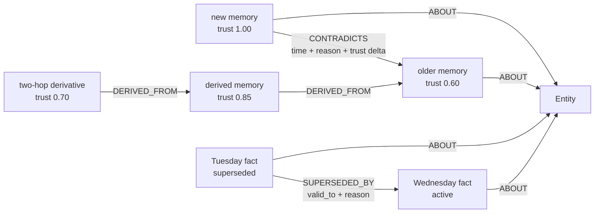
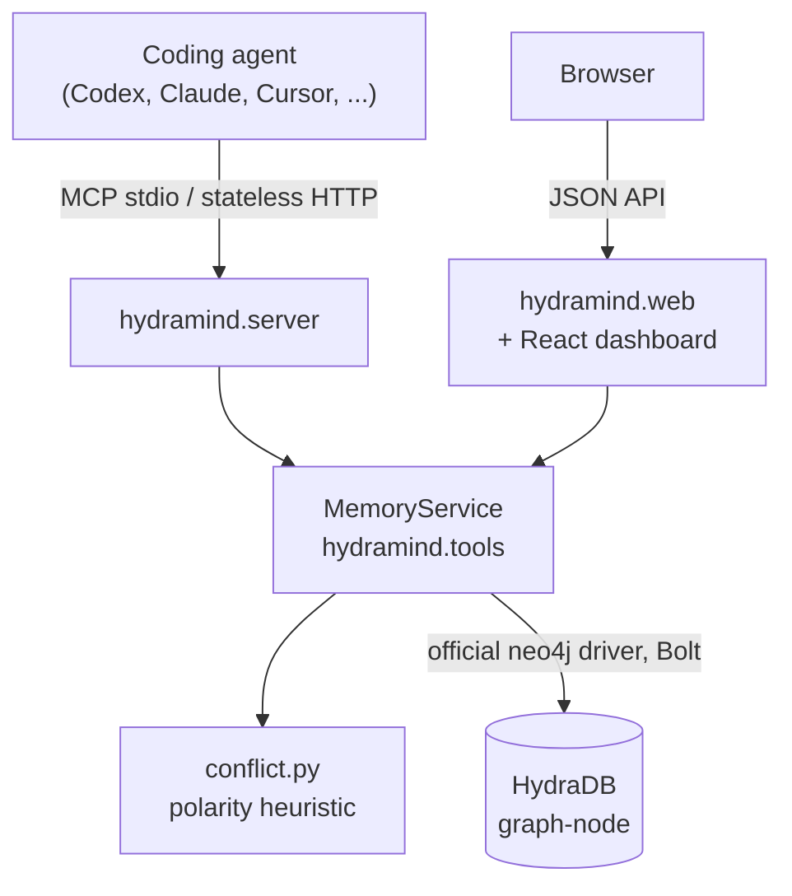

<div align="center">

# 🐉 HydraMind

**Persistent memory for coding agents that knows when it may be wrong.**

A graph-native [MCP](https://modelcontextprotocol.io) server that stores facts in
[HydraDB](https://github.com/hydra-db/hydradb), tracks contradictions and revisions,
propagates lost trust through provenance, and abstains instead of hallucinating.

[](https://github.com/himanshu748/hydramind/actions/workflows/ci.yml)
[](LICENSE)
[](pyproject.toml)
[](https://modelcontextprotocol.io)
[](https://docs.astral.sh/ruff/)
[](https://mypy-lang.org/)
[](CONTRIBUTING.md)

[Quickstart](#-quickstart) ·
[Tools](#-mcp-tools) ·
[How it works](#-how-it-works) ·
[Dashboard](#-dashboard) ·
[Contributing](CONTRIBUTING.md) ·
[Roadmap](#-roadmap)

</div>

---

## Table of contents

- [Why HydraMind?](#-why-hydramind)
- [Features](#-features)
- [Quickstart](#-quickstart)
- [Connect a coding agent](#-connect-a-coding-agent)
- [MCP tools](#-mcp-tools)
- [How it works](#-how-it-works)
- [Dashboard](#-dashboard)
- [Demo and evaluation](#-demo-and-evaluation)
- [Configuration](#-configuration)
- [Data model](#-data-model)
- [Testing and quality](#-testing-and-quality)
- [Project layout](#-project-layout)
- [Limits and guarantees](#-limits-and-guarantees)
- [Roadmap](#-roadmap)
- [Contributing](#-contributing)
- [Security](#-security)
- [Acknowledgements and license](#-acknowledgements-and-license)

## 💡 Why HydraMind?

Agents forget between sessions. Worse, the memory tools that fix that tend to treat
every stored sentence as equally true forever. When a fact changes, the old claim
and everything concluded from it keep ranking just as high.

HydraMind treats **uncertainty, revisions, and provenance as graph data**:

| Question | Plain vector store | HydraMind |
|---|---|---|
| "What is similar to this text?" | ✅ | ✅ (transparent lexical score) |
| "Which conclusions became less trustworthy when this fact changed?" | ❌ | ✅ `DERIVED_FROM` trust cascade |
| "What did we believe on Tuesday, and why did it change?" | ❌ | ✅ `SUPERSEDED_BY` timeline |
| "Show me the evidence behind this answer." | ❌ | ✅ native `algo.SSpaths` traces |
| "I don't know." | Rarely | ✅ empty result below 0.80 evidence |

Recall combines a scoped graph match with a transparent text score. If there is no
evidence it returns `[]`, so the agent can abstain instead of inventing an answer.

> Built for **Hack Hydra, Track 03: Memory + Context Retrieval** and the **Best Use
> of HydraDB** prize. Judges can start with the
> [Track 03 judge guide](TRACK03_JUDGE_GUIDE.md).

## ✨ Features

- **Eight MCP tools** with typed schemas: `remember`, `recall`, `revise`, `timeline`,
  `trace_memory`, `check_conflict`, `explain_trust`, `forget`.
- **Sessionless MCP `2026-07-28`** over stdio, plus explicitly stateless Streamable HTTP.
- **Trust that moves.** Contradictions lower the older claim by `0.40`, then lower its
  dependents for two hops by `0.15 × hop`, with a `0.05` floor.
- **Explicit time.** `revise` closes `valid_to`, writes a dated, reasoned
  `SUPERSEDED_BY` edge, and keeps the old fact auditable.
- **Evidence traces** through HydraDB's native `algo.SSpaths` engine, with scope guards.
- **First-class abstention.** Insufficient keyword evidence returns `[]`, including
  tested domain-overlap hard negatives.
- **Retry-safe writes.** Idempotency keys repair interrupted writes without applying
  decay twice.
- **No embeddings, no hosted model calls,** and no per-token bill on the retrieval path.
- **Live React dashboard** on the same memory service. Every trust change you see is
  persisted in HydraDB.
- **Docker is not required** anywhere.
- **Tested:** unit, live Bolt, real MCP stdio, stateless HTTP, restart, and concurrency
  tests, plus a repeatable stress gate.

## 🚀 Quickstart

### Prerequisites

- Linux or macOS. Windows is not supported yet because local write coordination uses
  POSIX `fcntl` locks ([#29](https://github.com/himanshu748/hydramind/issues/29)).
- Python **3.11+** and [`uv`](https://docs.astral.sh/uv/) (or plain `pip`).
- A source-built HydraDB `graph-node` listening on `neo4j://127.0.0.1:7687`. See
  HydraDB's [local server instructions](https://github.com/hydra-db/hydradb#run-a-local-server).
- The auth token that `graph-node` reads from `GRAPH_AUTH_TOKEN_FILE`.

HydraMind was checked against HydraDB commit
[`6a2fbb1`](https://github.com/hydra-db/hydradb/commit/6a2fbb192f37f51a93690a2ae2d2f5e27e6e4219)
(August 13, 2026).

### 1. Install

```bash
git clone https://github.com/himanshu748/hydramind.git
cd hydramind
uv sync --extra dev --locked
```

<details>
<summary>Without uv</summary>

```bash
python3 -m venv .venv
.venv/bin/python -m pip install -e '.[dev]'
```

</details>

### 2. Point it at HydraDB

```bash
export HYDRAMIND_TOKEN='local-development-token-32-bytes'

.venv/bin/python -c 'from hydramind.db import HydraDB; db = HydraDB(); db.verify_connection(); db.setup_schema(); print("HydraDB Bolt connection OK"); db.close()'
```

All settings are listed in [Configuration](#-configuration) and
[`.env.example`](.env.example).

### 3. Run

| Command | What it starts |
|---|---|
| `.venv/bin/hydramind` | MCP server over stdio. It waits silently for MCP messages; logs go to stderr. |
| `.venv/bin/hydramind-http` | Stateless Streamable HTTP MCP at `http://127.0.0.1:8788/mcp`. |
| `.venv/bin/hydramind-ui` | Landing page at `http://127.0.0.1:8787/` and live dashboard at `/app`. |
| `.venv/bin/python examples/demo.py` | End-to-end terminal demo on an isolated graph. |

HydraMind uses the official MCP Python SDK v2 and negotiates the sessionless
`2026-07-28` protocol, so requests never depend on a handshake or server-side session.
Every durable fact, relationship, and trust event lives in HydraDB. See the SDK's
[MCP 2.0 changes](https://github.com/modelcontextprotocol/python-sdk/blob/main/docs/whats-new.md).

## 🔌 Connect a coding agent

**Codex CLI**

```bash
codex mcp add hydramind \
  --env HYDRAMIND_TOKEN=local-development-token-32-bytes \
  --env HYDRAMIND_URI=neo4j://127.0.0.1:7687 \
  -- /absolute/path/to/hydramind/.venv/bin/hydramind
```

**Claude Desktop, Cursor, and other JSON-configured hosts**

```json
{
  "mcpServers": {
    "hydramind": {
      "command": "/absolute/path/to/hydramind/.venv/bin/hydramind",
      "env": {
        "HYDRAMIND_URI": "neo4j://127.0.0.1:7687",
        "HYDRAMIND_USERNAME": "neo4j",
        "HYDRAMIND_TOKEN": "local-development-token-32-bytes",
        "HYDRAMIND_DATABASE": "default"
      }
    }
  }
}
```

Restart the host after editing. Outside local development, inject the token through
the host's secret management instead of committing it to a config file.

**HTTP clients:** use `http://127.0.0.1:8788/mcp`. HydraMind forces JSON responses and
`stateless_http=True`, so a fresh client can recall data written by another client.
Bind to a non-loopback address only behind an authenticated gateway.

## 🧰 MCP tools

| Tool | Behavior |
|---|---|
| `remember(content, scope, entity_refs, derived_from?, idempotency_key?)` | Writes a trust-1.0 memory, `ABOUT` edges, optional lineage, and any detected contradiction plus cascading trust decay. Retrying the same key repairs unfinished apply phases and returns the original ID without repeating decay. Reusing a key with a different payload is rejected. |
| `recall(query, scope, entity_refs?, limit=10)` | Filters in Cypher by scope and optional entity IDs, normalizes question words and light word variants, omits candidates below 0.80 keyword coverage, then ranks by trust × keyword overlap. |
| `revise(memory_id, content, scope, reason?, entity_refs?)` | Replaces an active fact without erasing it. The old node becomes `superseded`, its validity closes, and a reasoned `SUPERSEDED_BY` edge points to the trust-1.0 revision. Entity links are inherited unless replacements are supplied. |
| `timeline(scope, entity_ref, limit=20)` | An entity's current and superseded facts in chronological order, with validity bounds and revision links. |
| `trace_memory(memory_id, scope, max_hops=2, max_paths=20)` | Calls HydraDB's native bounded single-source path engine and returns hydrated evidence paths. Paths containing an out-of-scope `Memory` are discarded. |
| `check_conflict(content, entity_refs, scope)` | Finds active memories about the same scoped entities and flags plausible opposite polarity, with a readable reason. |
| `explain_trust(memory_id, scope)` | Walks `CONTRADICTS`, `SUPERSEDED_BY`, and durable decay events, then narrates the ordered trust history. |
| `forget(memory_id, scope)` | Sets status to `forgotten` without deleting the node or breaking provenance edges. |

### Example session

```text
remember("Production deploys must always use direct routing.", "acme", ["deploy-policy"])
remember("Checklist follows deploy policy.", "acme", ["checklist"], derived_from=[root_id])
remember("Production deploys must not use direct routing.", "acme", ["deploy-policy"])
recall("How should production route?", "acme", ["deploy-policy"])
revise(runtime_id, "Agents use Python 3.13.", "acme", reason="Toolchain upgraded")
timeline("acme", "agent-runtime")
trace_memory(root_id, "acme")
```

The newest claim stays at trust `1.0`, the older claim becomes `contradicted` at
`0.6`, and the dependent checklist loses `0.15`. Both claims remain auditable.

## 🧠 How it works



1. **Write.** `remember` links the memory to scoped entities and optional parents.
2. **Detect.** A small, replaceable polarity heuristic
   ([`conflict.py`](src/hydramind/conflict.py)) checks active same-entity memories
   before the write.
3. **Propagate.** On contradiction, the older claim drops by `0.40`, and incoming
   `DERIVED_FROM` dependents drop by `0.15 × hop` for two hops. Each drop is stored as
   an immutable `TRUST_DECAY` event.
4. **Recall.** Candidates in scope are scored by `trust_score × keyword_overlap`.
   Anything below 0.80 coverage is dropped, so an empty list means "no evidence".
5. **Explain.** `explain_trust` and `trace_memory` turn the graph back into plain
   language and evidence paths.



## 📊 Dashboard

The React interface ships prebuilt inside the repository and Python package, so it
works right after install:

```bash
.venv/bin/hydramind-ui
```

- [http://127.0.0.1:8787/](http://127.0.0.1:8787/): landing page with an interactive trust cascade.
- [http://127.0.0.1:8787/app](http://127.0.0.1:8787/app): live HydraDB dashboard to
  seed a demo graph, recall, remember, revise, inspect timelines, run native traces,
  explain trust, and forget.

The UI uses the same Python memory service as the MCP tools. To work on the UI
itself, see [UI development](CONTRIBUTING.md#ui-development).

## 🎬 Demo and evaluation

With HydraDB running and `HYDRAMIND_TOKEN` set:

```bash
.venv/bin/python examples/demo.py          # add --keep to retain the isolated graph
.venv/bin/python -m benchmarks.track03_eval
```

The demo creates an isolated graph, shows two-hop provenance, catches a revision
before write, shows trust propagation and ranking, explains the old claim, proves
abstention, and cleans up.

The six-case Track 03 evaluation covers cross-service continuity, explicit chronology,
missing-information abstention, contradiction decay, two-hop provenance decay, and
native evidence tracing. A raw passing run is checked in at
[`benchmarks/results/track03-evaluation.json`](benchmarks/results/track03-evaluation.json).
It is a small reproducible smoke evaluation, not a LongMemEval result or a claim of
superiority over vector stores.

<details>
<summary>A three-minute walkthrough</summary>

1. Show the `Memory`/`Entity` graph and the two-hop `DERIVED_FROM` chain.
2. Insert an opposing production policy and show the persisted `CONTRADICTS` edge.
3. Show trust changing `1.0 → 0.6`, `1.0 → 0.85`, and `1.0 → 0.70`.
4. Revise the runtime fact and show the dated `SUPERSEDED_BY` timeline.
5. Trace a memory through native `algo.SSpaths`, then ask for absent information and get `[]`.

</details>

## 🔧 Configuration

| Variable | Default | Purpose |
|---|---|---|
| `HYDRAMIND_URI` | `neo4j://127.0.0.1:7687` | HydraDB Bolt URI |
| `HYDRAMIND_USERNAME` | `neo4j` | Bolt username |
| `HYDRAMIND_TOKEN` | unset | Preferred auth token |
| `HYDRAMIND_PASSWORD` | unset | Fallback if `HYDRAMIND_TOKEN` is absent |
| `HYDRAMIND_DATABASE` | `default` | Graph/database name |
| `HYDRAMIND_SOURCE` | `mcp` | Value stored in `Memory.source` |
| `HYDRAMIND_MAX_INFLIGHT_WRITES` | `8` | Per-process write backpressure, from 1 to 64 |
| `HYDRAMIND_MCP_HOST` | `127.0.0.1` | Stateless MCP HTTP bind address |
| `HYDRAMIND_MCP_PORT` | `8788` | Stateless MCP HTTP port |
| `HYDRAMIND_MCP_MAX_BODY_BYTES` | `1048576` | HTTP request body limit, capped at 4 MiB |
| `HYDRAMIND_UI_HOST` | `127.0.0.1` | Dashboard bind address |
| `HYDRAMIND_UI_PORT` | `8787` | Dashboard port |

HydraMind reads these from the process environment. To load
[`.env.example`](.env.example) after copying it to `.env`, run
`set -a; . ./.env; set +a`. Startup fails clearly when HydraDB or its token is
unavailable.

## 🗂 Data model

```text
(:Memory {
  id, content, source, created_at, valid_from, valid_to,
  scope, trust_score, status, write_phase
})
(:Entity {id, name, kind, scope})

(:Memory)-[:ABOUT]->(:Entity)
(:Memory)-[:CONTRADICTS {detected_at, reason, before_trust, after_trust, apply_status}]->(:Memory)
(:Memory)-[:SUPERSEDED_BY {revised_at, reason}]->(:Memory)
(:Memory)-[:DERIVED_FROM {
  last_decayed_at, last_decay_reason, before_trust, after_trust, decay_hop, caused_by
}]->(:Memory)
(:Memory)-[:TRUST_DECAY {
  detected_at, reason, before_trust, after_trust, hop, caused_by, apply_status
}]->(:Memory)
```

- External memory IDs are strings, because JSON and JavaScript cannot safely represent
  every 63-bit integer. HydraDB stores them as non-negative integer vertex IDs.
- Entity IDs are stable 63-bit hashes of scope plus name, so identical names cannot
  bridge scopes.
- Each `TRUST_DECAY` edge is an immutable event. The summary fields on `DERIVED_FROM`
  support quick inspection without overwriting history.
- HydraDB uses schema-on-write and does not support `CREATE CONSTRAINT`, so startup
  creates a versioned `HydraMindSchema` marker. Writes use `session.run(...)`
  auto-commit statements because the current Bolt runtime has no explicit
  transactions. Queries stay within HydraDB's documented
  [Cypher compatibility surface](https://github.com/hydra-db/hydradb/blob/main/cypher-compat.md).

## 🧪 Testing and quality

```bash
.venv/bin/pytest -m 'not integration'                                  # no database needed
HYDRAMIND_TOKEN=local-development-token-32-bytes .venv/bin/pytest      # full live suite
.venv/bin/ruff check src tests examples
.venv/bin/ruff format --check src tests examples
.venv/bin/mypy src
```

The live suite covers graph writes, scoped recall, entity filtering, ranking,
abstention, contradiction and two-hop decay, trust explanations, revision chronology,
scope-safe native tracing, non-destructive forgetting, real MCP stdio and stateless
HTTP round trips, persistence across processes, concurrent and cross-process write
races, idempotent retries with failures injected at five auto-commit boundaries, the
dashboard HTTP handler, and the Track 03 evaluation.

**Baseline (August 15, 2026):** 48 tests (18 database-independent, 30 live), 91%
coverage of the MCP and HydraDB core. CI rebuilds the UI and checks it matches
`ui/dist`, then runs Ruff, mypy, the database-independent tests, and `uv build`.

### Stress gate

```bash
HYDRAMIND_TOKEN=local-development-token-32-bytes \
  .venv/bin/python benchmarks/product_stress.py \
  --writes 250 --workers 8 --recall-probes 50 \
  --output benchmarks/results/product-stress-250.json
```

On the pinned local HydraDB node this wrote 250/250 unique memories at 4.747
writes/s (2,910 ms write p95), verified 50/50 exact recall targets at 40.1 ms p50 and
41.4 ms p95, and recalled the target after a fresh-driver restart. The raw result is
at [`benchmarks/results/product-stress-250.json`](benchmarks/results/product-stress-250.json).
It measures durability and backpressure on one machine, not maximum throughput.

## 📁 Project layout

```text
src/hydramind/
  db.py          HydraDB connection, Bolt errors, schema marker
  conflict.py    Replaceable conflict heuristic
  tools.py       Memory graph and the eight tool implementations
  server.py      MCP server v2 tools, sessionless stdio, stateless HTTP
  web.py         Local JSON API and landing/dashboard server
ui/src/          React + Vite + TypeScript dashboard (built output in ui/dist)
examples/        Terminal demo
benchmarks/      Track 03 evaluation, stress gate, checked-in results
tests/           Unit, live HydraDB, MCP transport, and web tests
design.md        Design system for visual surfaces
```

## 🧭 Limits and guarantees

These limits are deliberate and documented so you can tell what is guaranteed from
what is future work.

- **Lexical, not semantic.** Conflict detection and relevance use transparent keyword
  heuristics. `conflict.py` isolates the classifier so it can be replaced.
- **Bounded graph work.** Trust propagation stops at two hops. Traces stop at three
  hops and 100 paths. Recall returns at most 100 ranked results.
- **Recall scans the scope.** Every eligible candidate in a scope is scored. Large
  deployments should partition scopes and benchmark latency.
- **Not crash-atomic.** HydraDB's Bolt surface is auto-commit only. Local writers are
  coordinated, and keyed `remember` retries repair unfinished phases. Unkeyed writes
  and revisions are not distributed transactions.
- **Scope is not auth.** Scope partitions and guards queries. It is not authentication
  or tenant authorization. Put an authenticated gateway in front of any remote,
  multi-user deployment.

## 🗺 Roadmap

Ideas where contributions are especially welcome:

- [ ] Pluggable semantic conflict classifier behind the `conflict.py` interface ([#9](https://github.com/himanshu748/hydramind/issues/9))
- [ ] Optional embedding-assisted recall that keeps the abstention guarantee ([#11](https://github.com/himanshu748/hydramind/issues/11))
- [ ] Indexed candidate selection for very large scopes ([#14](https://github.com/himanshu748/hydramind/issues/14), [#15](https://github.com/himanshu748/hydramind/issues/15))
- [ ] Configurable decay constants and hop limits ([#7](https://github.com/himanshu748/hydramind/issues/7), [#8](https://github.com/himanshu748/hydramind/issues/8))
- [ ] Packaged releases on PyPI ([#17](https://github.com/himanshu748/hydramind/issues/17))
- [ ] Larger public benchmark runs, such as LongMemEval ([#27](https://github.com/himanshu748/hydramind/issues/27))
- [ ] Windows support ([#29](https://github.com/himanshu748/hydramind/issues/29))
- [ ] More MCP host setup guides ([#18](https://github.com/himanshu748/hydramind/issues/18), [#19](https://github.com/himanshu748/hydramind/issues/19))

Browse [all open issues](https://github.com/himanshu748/hydramind/issues). Have another idea? [Open a feature request](https://github.com/himanshu748/hydramind/issues/new/choose).

## 🤝 Contributing

Contributions of all sizes are welcome, from typo fixes to new retrieval strategies.
Start with [CONTRIBUTING.md](CONTRIBUTING.md) for setup, workflow, and coding
standards, and look for issues labelled
[`good first issue`](https://github.com/himanshu748/hydramind/labels/good%20first%20issue).

Everyone taking part is expected to follow the [Code of Conduct](CODE_OF_CONDUCT.md).
Notable changes are recorded in the [changelog](CHANGELOG.md).

## 🔒 Security

Please do **not** open public issues for vulnerabilities. See
[SECURITY.md](SECURITY.md) for private reporting.

## 🙏 Acknowledgements and license

HydraMind started as original Hack Hydra hackathon work. It builds on:

- [HydraDB](https://github.com/hydra-db/hydradb): external AGPL-3.0 software accessed
  over Bolt, not vendored.
- [MCP Python SDK](https://github.com/modelcontextprotocol/python-sdk) (MIT) and the
  [Neo4j Python driver](https://github.com/neo4j/neo4j-python-driver) (Apache-2.0).
- React, Vite, TypeScript, and Lucide for the UI. Bundled Inter, IBM Plex Mono, and
  Space Grotesk fonts use the SIL Open Font License.

Dependency versions and license metadata are in `uv.lock` and `ui/package-lock.json`.

HydraMind is released under the [MIT License](LICENSE).

<div align="center">

If HydraMind helps your agents remember responsibly, please ⭐ the repo.

</div>
