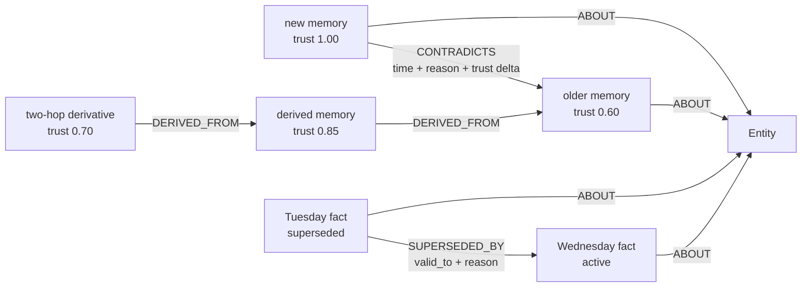

# HydraMind

**Persistent memory that knows when it may be wrong.**

HydraMind is a Python MCP server for coding agents. It stores facts in HydraDB,
connects them to the entities they describe, detects plausible revisions, and
propagates lost trust through memory provenance. Recall combines a scoped graph
match with a transparent text score; if there is no evidence, it returns an empty
list so the agent can abstain instead of inventing an answer.

Built for **Hack Hydra, Track 03: Memory + Context Retrieval** and the
**Best Use of HydraDB** prize.

Judges can start with the concise [Track 03 judge guide](TRACK03_JUDGE_GUIDE.md),
which maps every official "strong work" signal to a live product behavior and a
reproducible check.

## Why this needs a graph

A vector store can retrieve similar sentences. It does not naturally answer
"which downstream conclusions became less trustworthy when this fact changed?"
HydraMind makes that dependency structure first-class:



When the new memory contradicts the older one, HydraMind lowers the old claim by
`0.40`, then walks incoming `DERIVED_FROM` dependencies for two hops and lowers
them by `0.15 × hop`. The graph preserves the contradiction, timestamp, reason,
and provenance; `explain_trust` turns that history back into plain language.

## What works

- Eight MCP tools with typed schemas and judge-readable descriptions.
- Sessionless MCP `2026-07-28` over stdio, plus explicitly stateless Streamable HTTP.
- Official `neo4j` Python driver connected to HydraDB over Bolt, with no custom client.
- Scoped and entity-filtered recall ranked by `trust_score × keyword_overlap`,
  with a conservative 0.80 lexical evidence threshold.
- Scope-specific entity identities and mandatory scope guards on every direct-ID tool.
- Pre-write conflict detection using a small, replaceable polarity heuristic.
- Contradiction edges, trust decay with a `0.05` floor, and two-hop lineage decay.
- Explicit fact revision with `valid_from`/`valid_to`, a dated and reasoned
  `SUPERSEDED_BY` edge, and inherited entity links.
- Entity timelines that keep superseded facts auditable while recall returns the
  current version by default.
- Scope-safe evidence tracing through HydraDB's native `algo.SSpaths` engine over
  `ABOUT`, `CONTRADICTS`, `DERIVED_FROM`, and `SUPERSEDED_BY` relationships.
- Optional `derived_from` memory IDs on `remember`, so agents can create real
  provenance without needing another tool.
- Explainable trust history and non-destructive forgetting.
- Retry-safe writes through optional idempotency keys, plus bounded inputs and local
  cross-process writer coordination.
- Explicit lexical abstention: insufficient keyword evidence returns `[]`, including
  tested domain-overlap hard negatives.
- Clear startup failures when HydraDB or its auth token is unavailable.
- Unit, live Bolt, real MCP stdio, stateless HTTP, restart, and concurrency tests.

## Prerequisites

- Python 3.11 or newer.
- A source-built `graph-node` already listening on `neo4j://127.0.0.1:7687`.
- The auth token used to start that node.

**Docker is not required anywhere in this project.** If `graph-node` is not
already running, use HydraDB's official
[source-native local server instructions](https://github.com/hydra-db/hydradb#run-a-local-server).

HydraMind was checked against HydraDB commit
[`6a2fbb1`](https://github.com/hydra-db/hydradb/commit/6a2fbb192f37f51a93690a2ae2d2f5e27e6e4219)
from August 13, 2026. Its native build check, smoke test, and runtime smoke script
all passed before HydraMind's Bolt, transport, browser, and stress gates were run.

## Install

With `uv`:

```bash
uv sync --extra dev --locked
```

Or with the standard library and pip:

```bash
python3 -m venv .venv
.venv/bin/python -m pip install -e '.[dev]'
```

Set the same token that `graph-node` reads from `GRAPH_AUTH_TOKEN_FILE`:

```bash
export HYDRAMIND_TOKEN='local-development-token-32-bytes'
```

Confirm the actual Bolt connection before starting MCP:

```bash
.venv/bin/python -c 'from hydramind.db import HydraDB; db = HydraDB(); db.verify_connection(); db.setup_schema(); print("HydraDB Bolt connection OK"); db.close()'
```

Then start the stdio server:

```bash
.venv/bin/hydramind
```

The process waits silently for MCP messages on stdin. Logs and actionable startup
errors go to stderr so they do not corrupt the protocol stream.

HydraMind uses the official MCP Python SDK v2 and negotiates the sessionless
`2026-07-28` protocol. Requests do not depend on an MCP handshake or server-side
session. The process keeps only reusable infrastructure, the Neo4j driver pool and
memory service, while every durable fact, relationship, and trust event lives in
HydraDB. See the official SDK's
[MCP 2.0 changes](https://github.com/modelcontextprotocol/python-sdk/blob/main/docs/whats-new.md).

To expose the same tools over stateless Streamable HTTP:

```bash
.venv/bin/hydramind-http
```

The endpoint is `http://127.0.0.1:8788/mcp`. HydraMind forces JSON responses and
`stateless_http=True` for legacy clients, so a fresh client can recall data written
by another client without inheriting transport state. Set a different bind address
only when you have also added authentication at a trusted local gateway.

## Attach a coding agent

Codex CLI:

```bash
codex mcp add hydramind \
  --env HYDRAMIND_TOKEN=local-development-token-32-bytes \
  --env HYDRAMIND_URI=neo4j://127.0.0.1:7687 \
  -- /absolute/path/to/hydramind/.venv/bin/hydramind
```

For JSON-style MCP hosts such as Claude Desktop or Cursor, add this server entry
and restart the host:

```json
{
  "mcpServers": {
    "hydramind": {
      "command": "/absolute/path/to/hydramind/.venv/bin/hydramind",
      "env": {
        "HYDRAMIND_URI": "neo4j://127.0.0.1:7687",
        "HYDRAMIND_USERNAME": "neo4j",
        "HYDRAMIND_TOKEN": "local-development-token-32-bytes",
        "HYDRAMIND_DATABASE": "default"
      }
    }
  }
}
```

For anything beyond local development, inject the token through the host's secret
management instead of committing it to a config file.

## MCP tools

| Tool | Behavior |
|---|---|
| `remember(content, scope, entity_refs, derived_from?, idempotency_key?)` | Writes a trust-1.0 memory, `ABOUT` edges, optional lineage, and any detected contradiction plus cascading trust decay. Retrying the same key repairs any unfinished apply phases and returns the original ID without repeating decay; reusing it with another payload is rejected. |
| `recall(query, scope, entity_refs?, limit=10)` | Filters in Cypher by scope and optional entity IDs, normalizes question words and light word variants, omits candidates below 0.80 keyword coverage, then ranks by trust times keyword overlap. Returns content, trust, status, and creation time. |
| `revise(memory_id, content, scope, reason?, entity_refs?)` | Replaces an active fact without erasing it. The old node becomes `superseded`, temporal validity is closed, and a reasoned `SUPERSEDED_BY` edge points to the trust-1.0 revision. Entity links are inherited unless replacements are supplied. |
| `timeline(scope, entity_ref, limit=20)` | Returns the entity's current and superseded facts in chronological order with validity bounds and revision links. |
| `trace_memory(memory_id, scope, max_hops=2, max_paths=20)` | Calls HydraDB's native bounded single-source path engine and returns hydrated evidence paths. Paths containing an out-of-scope `Memory` are discarded. |
| `check_conflict(content, entity_refs, scope)` | Finds active memories about the same scoped entities and flags plausible opposite polarity, with a readable reason. |
| `explain_trust(memory_id, scope)` | Walks `CONTRADICTS`, `SUPERSEDED_BY`, and durable derived-decay events, then narrates the ordered trust history. |
| `forget(memory_id, scope)` | Sets status to `forgotten`; it does not delete the node or break provenance edges. |

Example agent behavior:

```text
remember("Production deploys must always use direct routing.", "acme", ["deploy-policy"])
remember("Checklist follows deploy policy.", "acme", ["checklist"], derived_from=[root_id])
remember("Production deploys must not use direct routing.", "acme", ["deploy-policy"])
recall("How should production route?", "acme", ["deploy-policy"])
revise(runtime_id, "Agents use Python 3.13.", "acme", reason="Toolchain upgraded")
timeline("acme", "agent-runtime")
trace_memory(root_id, "acme")
```

The revision remains at trust `1.0`, the older claim becomes `contradicted` at
`0.6`, and the dependent checklist loses `0.15`. Both claims remain auditable.

## Run the graph-native demo

With local HydraDB running and `HYDRAMIND_TOKEN` set:

```bash
.venv/bin/python examples/demo.py
```

The script creates an isolated graph, demonstrates two-hop provenance, catches a
revision before write, shows trust propagation and ranking, explains the old
claim, proves abstention, and cleans up. Add `--keep` to retain the isolated graph
for inspection.

A tight three-minute judging flow is:

1. Show the `Memory`/`Entity` graph and two-hop `DERIVED_FROM` chain.
2. Insert an opposing production policy and show the persisted `CONTRADICTS` edge.
3. Show trust changing from `1.0 → 0.6`, `1.0 → 0.85`, and `1.0 → 0.70`.
4. Revise the runtime fact and show the dated `SUPERSEDED_BY` timeline.
5. Trace a memory through native `algo.SSpaths`, then ask for absent information and get `[]`.

For a machine-readable judge check, run the six-case Track 03 smoke evaluation:

```bash
HYDRAMIND_TOKEN=local-development-token-32-bytes \
  .venv/bin/python -m benchmarks.track03_eval
```

It covers cross-service continuity, explicit chronology, missing-information
abstention, contradiction decay, two-hop provenance decay, and native evidence
tracing. A representative raw passing run is checked in at
[`benchmarks/results/track03-evaluation.json`](benchmarks/results/track03-evaluation.json).
This is a
small reproducible smoke evaluation, not a claim of LongMemEval or vector-store
superiority.

## Open the landing page and live graph

The React interface is a code-native companion to the MCP server. Its landing
page explains why trust-weighted graph memory matters, and `/app` is a working
HydraDB dashboard where judges can recall, remember, revise facts, inspect entity
timelines, run native evidence traces, explain trust, and forget memories without
leaving the demo.

The production interface is included in the repository and Python package, so it
works immediately after the Python install. Start the local server with HydraDB
and `HYDRAMIND_TOKEN` already configured:

```bash
.venv/bin/hydramind-ui
```

Only rebuild the interface after changing its source:

```bash
cd ui
npm ci
npm run build
cd ..
```

Open [http://127.0.0.1:8787/](http://127.0.0.1:8787/) for the landing page or
[http://127.0.0.1:8787/app](http://127.0.0.1:8787/app) for the live graph. The UI
uses the same Python memory service as the MCP tools, so every visible trust
change is persisted in HydraDB rather than simulated client state.

## Data model

```text
(:Memory {
  id, content, source, created_at, valid_from, valid_to,
  scope, trust_score, status, write_phase
})
(:Entity {id, name, kind, scope})

(:Memory)-[:ABOUT]->(:Entity)
(:Memory)-[:CONTRADICTS {
  detected_at, reason, before_trust, after_trust, apply_status
}]->(:Memory)
(:Memory)-[:SUPERSEDED_BY {
  revised_at, reason
}]->(:Memory)
(:Memory)-[:DERIVED_FROM {
  last_decayed_at, last_decay_reason, before_trust, after_trust,
  decay_hop, caused_by
}]->(:Memory)
(:Memory)-[:TRUST_DECAY {
  detected_at, reason, before_trust, after_trust, hop, caused_by, apply_status
}]->(:Memory)
```

External memory IDs are strings because JSON and JavaScript cannot represent every
63-bit integer safely; HydraDB stores them as non-negative integer vertex IDs.
Entity IDs are stable 63-bit hashes of scope plus name, so identical names cannot
bridge scopes. Each `TRUST_DECAY` edge is an immutable event; the summary fields on
`DERIVED_FROM` remain useful for graph inspection without overwriting its history.
Keyed writes and their trust events carry durable apply phases, so a retry can
repair an interrupted multi-statement operation without applying decay twice.

HydraDB currently uses schema-on-write and does not support `CREATE CONSTRAINT`,
so startup creates a versioned `HydraMindSchema` marker instead of issuing
unsupported DDL. Writes use `session.run(...)` auto-commit statements because the
current Bolt runtime does not support explicit transactions. Queries intentionally
stay within HydraDB's documented
[Cypher compatibility surface](https://github.com/hydra-db/hydradb/blob/main/cypher-compat.md).

## Configuration

| Variable | Default | Purpose |
|---|---|---|
| `HYDRAMIND_URI` | `neo4j://127.0.0.1:7687` | HydraDB Bolt URI |
| `HYDRAMIND_USERNAME` | `neo4j` | Bolt username |
| `HYDRAMIND_TOKEN` | unset | Preferred local auth token |
| `HYDRAMIND_PASSWORD` | unset | Fallback if `HYDRAMIND_TOKEN` is absent |
| `HYDRAMIND_DATABASE` | `default` | Graph/database name |
| `HYDRAMIND_SOURCE` | `mcp` | Value stored in `Memory.source` |
| `HYDRAMIND_MAX_INFLIGHT_WRITES` | `8` | Per-process write backpressure, from 1 to 64 |
| `HYDRAMIND_MCP_HOST` | `127.0.0.1` | Stateless MCP HTTP bind address |
| `HYDRAMIND_MCP_PORT` | `8788` | Stateless MCP HTTP port |
| `HYDRAMIND_MCP_MAX_BODY_BYTES` | `1048576` | HTTP request body limit, capped at 4 MiB |
| `HYDRAMIND_UI_HOST` | `127.0.0.1` | Dashboard bind address |
| `HYDRAMIND_UI_PORT` | `8787` | Dashboard port |

## Cost and scale boundaries

HydraMind makes no embedding or hosted-model call, so the core retrieval path has
no per-token API bill. Recall asks HydraDB for every active or contradicted candidate
in the selected scope, returns at most 100 after ranking, and performs only a set-overlap
score in Python; candidates below 0.80 query-keyword coverage are omitted. Conflict checks scan active same-entity candidates in the selected
scope. This favors retrieval correctness over a silent recency cutoff. Trust
propagation is deliberately bounded to two graph hops. Native evidence traces are
bounded to three hops and 100 hydrated paths. These are explicit safety
limits, not claims of unlimited scale; a future benchmark should tune them against
measured quality and latency.

## Tests and quality checks

Fast tests do not require HydraDB:

```bash
.venv/bin/pytest -m 'not integration'
```

Run everything against the local Bolt endpoint:

```bash
HYDRAMIND_TOKEN=local-development-token-32-bytes .venv/bin/pytest
```

The live integration suite verifies graph writes, scoped recall, entity filtering,
ranking, abstention, contradiction decay, two-hop derived decay, trust
explanations, explicit revision chronology, scope-safe native path tracing,
non-destructive forgetting, a real MCP client/server stdio round trip, persistence
across separate server processes, stateless HTTP across fresh clients, concurrent
HTTP writes, cross-process contradictory writes and revision races, idempotent
retries, durable repeated trust events, the real dashboard HTTP handler, dashboard
graph state, and the six-case Track 03 evaluation.

The August 15, 2026 full run is **48 tests**: 18 database-independent tests and 30 tests
that require the live Bolt endpoint. Three of those exercise real MCP transports
(two stdio and one stateless HTTP); the rest test the graph service and dashboard
API directly. The live suite injects failures at five auto-commit boundaries and
proves an idempotent retry completes the missing graph and trust work exactly once.
Regenerated coverage is **91% for the MCP and HydraDB core**. A local manual browser
pass separately verified landing → dashboard → demo seed →
trust-weighted recall → trust explanation → native trace → scoped graph switching;
CI builds the production UI and runs the database-independent 18-test subset. The
manual browser pass is not presented as an automated CI result.

## Repeatable stress gate

The stress runner uses the real `MemoryService`, concurrent writers, scoped recall,
and a brand-new driver after the write phase:

```bash
HYDRAMIND_TOKEN=local-development-token-32-bytes \
  .venv/bin/python benchmarks/product_stress.py \
  --writes 250 --workers 8 --recall-probes 50 \
  --output benchmarks/results/product-stress-250.json
```

On the source-built local HydraDB node pinned above, the sustainable profile wrote
250/250 unique memories at 4.747 writes/second with 2,910.492 ms write p95,
verified 50/50 exact recall targets at 40.141 ms p50 and 41.420 ms p95, and recalled
the exact target after a fresh-driver restart. The provenance-stamped raw result is
checked in at
[`benchmarks/results/product-stress-250.json`](benchmarks/results/product-stress-250.json).
This is a durability/backpressure measurement, not an unlimited-throughput claim;
results vary with local hardware and store compaction state.

```bash
.venv/bin/ruff check src tests examples
.venv/bin/ruff format --check src tests examples
.venv/bin/mypy src
```

## Project layout

```text
src/hydramind/db.py        HydraDB connection, Bolt errors, schema marker
src/hydramind/conflict.py  Replaceable conflict heuristic
src/hydramind/tools.py     Memory graph and the eight tool implementations
src/hydramind/server.py    MCPServer v2 tools, sessionless stdio, stateless HTTP
src/hydramind/web.py       Local JSON API and landing/dashboard server
benchmarks/track03_eval.py Six-case live Track 03 smoke evaluation
benchmarks/product_stress.py Repeatable concurrent write/recall/restart stress gate
ui/src/BrandMark.tsx       Custom graph-hydra identity mark
ui/src/LandingPage.tsx     Product landing page and trust cascade interaction
ui/src/App.tsx             Live HydraDB trust graph dashboard
examples/demo.py           Repeatable judge-facing trust propagation story
tests/test_mcp_stdio.py     Protocol negotiation and process restart persistence
tests/test_mcp_http.py      Fresh-client persistence and concurrent stateless writes
tests/                     Unit, live HydraDB, and transport tests
design.md                  Required design system for any future visual surface
```

## Deliberate limits

- Conflict detection is lexical, not semantic. It is isolated in `conflict.py`
  specifically so an LLM classifier can replace it later.
- Text relevance is keyword overlap, not an embedding model. Trust and graph
  structure stay independently inspectable.
- HydraDB's current auto-commit-only Bolt surface means multi-statement writes are
  coordinated across local HydraMind processes. A keyed `remember` retry repairs
  recorded-but-unfinished phases, but unkeyed writes and revisions are not
  crash-atomic; this is not a distributed transaction.
- Scope is a required data partition and query guard, not authentication or tenant
  authorization. Put an authenticated gateway in front of remote multi-user use.
- Recall scores every non-forgotten, non-superseded candidate in the selected scope;
  very large deployments should partition scopes and benchmark their own latency.
- Native trace isolation uses scope-specific Entity IDs, bounded overfetch, and a
  final path guard that omits any path containing an out-of-scope memory.

## Attribution

HydraMind is original hackathon work built on open-source infrastructure. HydraDB
is an external AGPL-3.0 graph database; HydraMind communicates with it over Bolt
and does not vendor its source. The Python server uses the MIT-licensed MCP SDK
and the Apache-2.0/Python-2.0 Neo4j driver. The interface uses React, Vite,
TypeScript, and Lucide under their respective open-source licenses. Bundled Inter,
IBM Plex Mono, and Space Grotesk font files are distributed under the SIL Open
Font License. Exact dependency versions and package license metadata are recorded
in `uv.lock` and `ui/package-lock.json`.

## License

MIT
