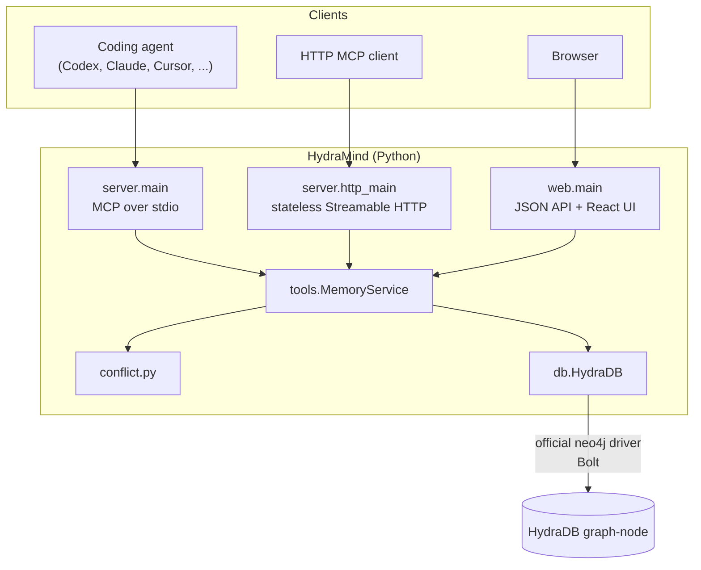
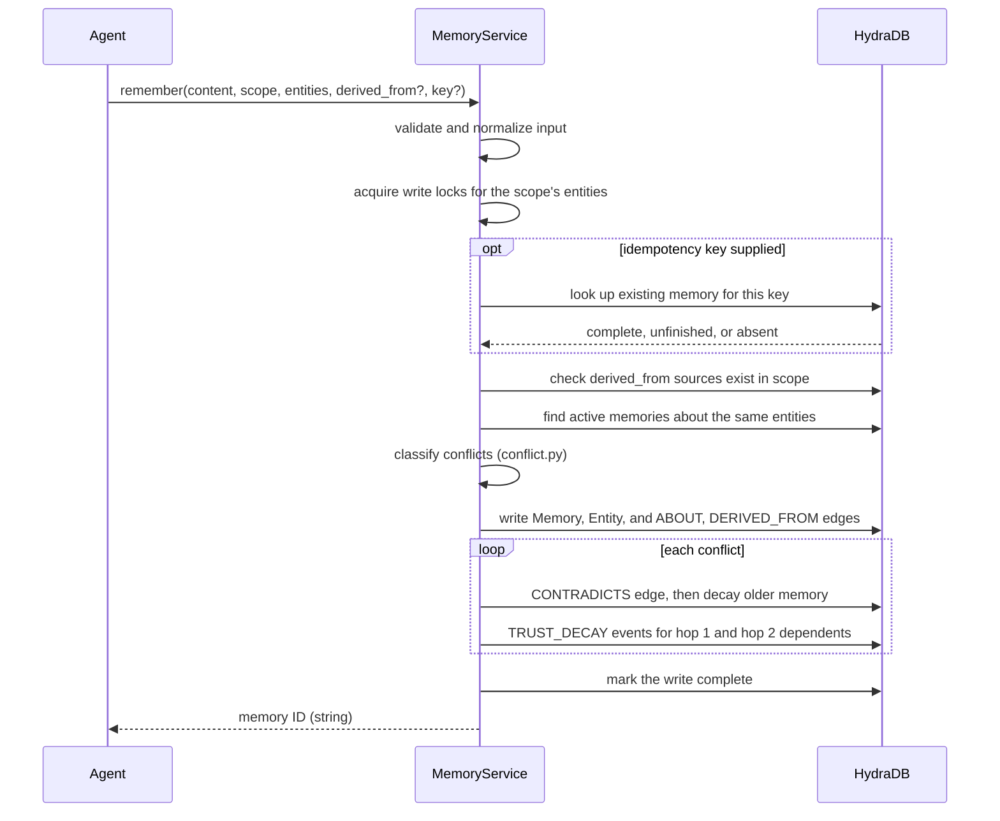

# Architecture

HydraMind is a small Python service between MCP clients and a HydraDB graph. It
holds no durable state of its own: every fact, edge, and trust event lives in
HydraDB, so any process can serve any request.

## Components

| Module | Responsibility |
|---|---|
| [`server.py`](../src/hydramind/server.py) | Registers the eight MCP tools with typed schemas. Runs sessionless MCP `2026-07-28` over stdio, or stateless Streamable HTTP with JSON responses and a request size limit. |
| [`web.py`](../src/hydramind/web.py) | Serves the landing page, the dashboard at `/app`, and a local JSON API over the same `MemoryService`. |
| [`tools.py`](../src/hydramind/tools.py) | All memory behavior: input validation, scoped queries, ranking, conflicts, trust decay, revisions, traces, and write coordination. |
| [`conflict.py`](../src/hydramind/conflict.py) | The replaceable lexical polarity classifier. |
| [`db.py`](../src/hydramind/db.py) | Bolt connection, actionable startup errors, and the schema marker. |
| [`ui/`](../ui) | React, Vite, and TypeScript dashboard. The built output in `ui/dist` ships inside the Python package. |

## Request flow: `remember`

`recall` is read-only: one scoped Cypher query fetches candidates, then Python
scores keyword coverage, drops anything below `0.80`, and ranks the rest by
`trust_score × coverage`.

## Concurrency

HydraDB's Bolt runtime has no explicit transactions, so HydraMind coordinates
multi-statement writes itself:

- **Within a process:** writes take striped locks (64 stripes) keyed by scope and
  entity, so writes about unrelated entities run in parallel.
- **Across processes:** each stripe also takes an exclusive POSIX `fcntl` lock on a
  file in the system temp directory. The file name is derived from the HydraDB URI
  and database, so several HydraMind processes on one host that point at the same
  graph serialize conflicting writes.
- **Backpressure:** `HYDRAMIND_MAX_INFLIGHT_WRITES` (default `8`) caps concurrent
  writes per process.

Because the locks are host-local files, HydraMind on separate machines writing to
the same graph is **not** coordinated. The `fcntl` dependency is also why Windows is
unsupported ([#29](https://github.com/himanshu748/hydramind/issues/29)).

## Transports

| Entry point | Transport | State |
|---|---|---|
| `hydramind` | stdio | Sessionless. Logs go to stderr so they never corrupt the protocol stream. |
| `hydramind-http` | Streamable HTTP at `/mcp` | `stateless_http=True` with JSON responses. A fresh client can read what another client wrote. |
| `hydramind-ui` | HTTP JSON API | Same service. Binds to `127.0.0.1` by default. |

All three keep only reusable infrastructure in memory, namely the driver pool and
the service object.

## Design choices

- **Graph first.** Contradictions, revisions, lineage, and trust changes are edges
  rather than log lines, so they can be traversed and explained.
- **No model calls on the core path.** Retrieval and conflict detection are lexical,
  so behavior is predictable, testable, and free to run.
- **Abstain rather than guess.** Below `0.80` keyword coverage, `recall` returns `[]`.
- **Never delete.** `forget` and `revise` change status. History stays intact.
- **Bounded work.** Two-hop propagation, three-hop traces, and at most 100 paths or
  results keep each request predictable.

See the [graph model](graph-model.md) for the schema and the
[trust model](trust-model.md) for the decay rules.
