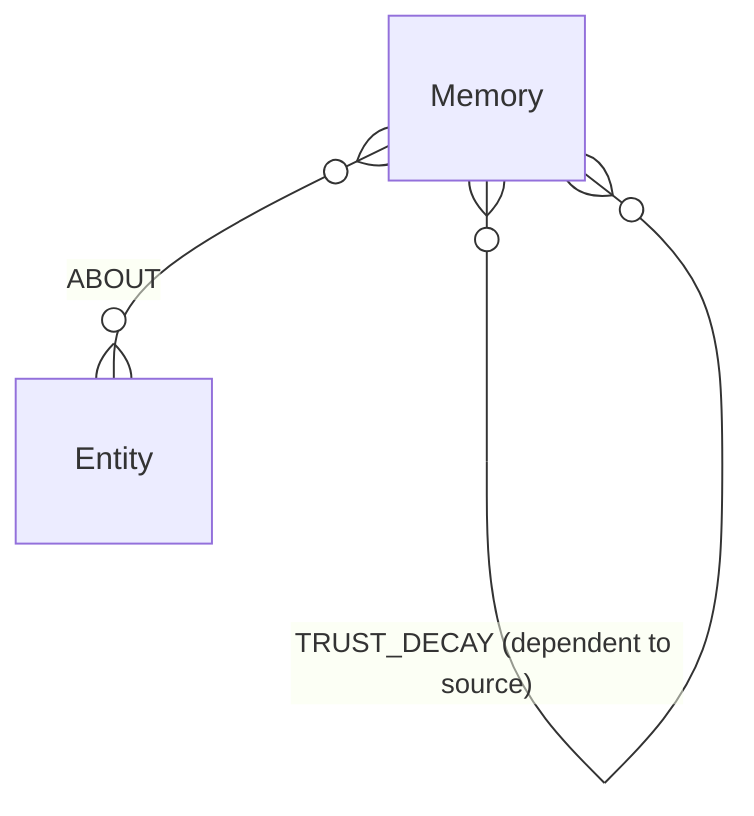
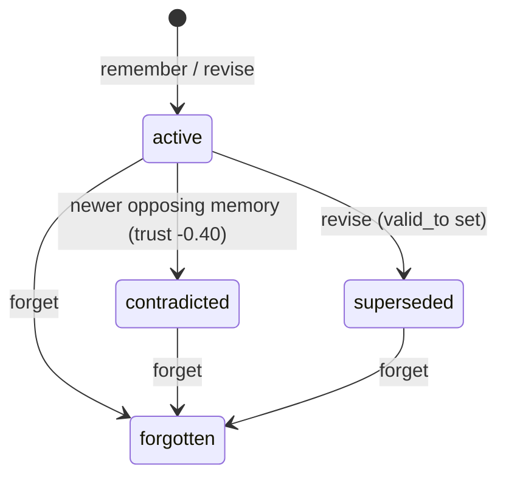

# Graph model

HydraMind stores every memory, entity, contradiction, revision, and trust change as
graph data in HydraDB. This page describes the schema, how IDs work, how a memory's
status changes, and how to query the graph yourself.

- [Nodes](#nodes)
- [Relationships](#relationships)
- [Identifiers](#identifiers)
- [Memory lifecycle](#memory-lifecycle)
- [Scopes](#scopes)
- [Explore the graph with Cypher](#explore-the-graph-with-cypher)
- [Compatibility notes](#compatibility-notes)

## Overview



## Nodes

### `Memory`

One claim an agent stored with `remember` or `revise`.

| Property | Type | Meaning |
|---|---|---|
| `id` | integer | Stable 63-bit vertex ID. Exposed to clients as a string. |
| `content` | string | The claim text, up to 32,768 characters. |
| `scope` | string | Partition the memory belongs to, for example a project or tenant name. |
| `source` | string | Writer label from `HYDRAMIND_SOURCE`, for example `mcp` or `ui`. |
| `created_at` | ISO-8601 UTC string | When the memory was written. |
| `valid_from` | ISO-8601 UTC string | Start of the period the fact is considered current. |
| `valid_to` | ISO-8601 UTC string or null | Set when `revise` supersedes the fact. |
| `trust_score` | float, `0.05` to `1.0` | Current trust. New memories start at `1.0`. |
| `status` | string | `active`, `contradicted`, `superseded`, or `forgotten`. |
| `write_phase` | string | Progress marker so an idempotent retry can finish an interrupted write. |
| `request_fingerprint` | string | Hash of the request, used to reject reusing an idempotency key with a different payload. |

### `Entity`

A named thing memories are about, such as `deploy-policy` or `agent-runtime`.

| Property | Type | Meaning |
|---|---|---|
| `id` | integer | Stable hash of scope plus normalized name. |
| `name` | string | Entity reference, trimmed, with whitespace collapsed and case folded. |
| `kind` | string | Entity category. Currently always `reference`. |
| `scope` | string | Same partition as the memories that reference it. |

### `HydraMindSchema`

A single marker node written at startup. HydraDB is schema-on-write and does not
support `CREATE CONSTRAINT`, so this marker records the schema version and lets
startup confirm the connection.

## Relationships

| Relationship | Direction | Written by | Properties |
|---|---|---|---|
| `ABOUT` | `Memory → Entity` | `remember`, `revise` | `id` |
| `CONTRADICTS` | newer `Memory →` older `Memory` | `remember`, `revise` when a conflict is detected | `detected_at`, `reason`, `before_trust`, `after_trust`, `apply_status` |
| `SUPERSEDED_BY` | older `Memory →` newer `Memory` | `revise` | `revised_at`, `reason` |
| `DERIVED_FROM` | dependent `Memory →` source `Memory` | `remember(..., derived_from=[...])` | `id`, plus a summary of the latest decay: `last_decayed_at`, `last_decay_reason`, `before_trust`, `after_trust`, `decay_hop`, `caused_by` |
| `TRUST_DECAY` | dependent `Memory →` source `Memory` | contradiction propagation | `detected_at`, `reason`, `before_trust`, `after_trust`, `hop`, `caused_by`, `apply_status` |

`TRUST_DECAY` edges are immutable events: each contradiction that reaches a dependent
adds a new edge. The summary fields on `DERIVED_FROM` are overwritten on each decay
and exist only for quick inspection. Use `TRUST_DECAY` for history.

`caused_by` is the ID of the memory that was contradicted, the root of the cascade.

## Identifiers

All IDs are non-negative integers below 2⁶³. The top bits encode the kind:

| Kind | ID derivation |
|---|---|
| Memory (no idempotency key) | Random 61-bit payload |
| Memory (with idempotency key) | Hash of `scope` and the key, so retries resolve to the same node |
| Entity | Hash of `scope` and the normalized name |
| Relationship | Hash of the relationship type and both endpoint IDs |
| `TRUST_DECAY` event | Hash of the dependent, source, root cause, and detection time |

Clients receive memory IDs as strings, because JSON and JavaScript cannot represent
every 63-bit integer exactly. Because entity IDs include the scope, two scopes that
use the same entity name get different `Entity` nodes and never share edges.

## Memory lifecycle



| Status | Returned by `recall` | Shown in `timeline` | Can be contradicted again | Can be revised |
|---|---|---|---|---|
| `active` | yes | yes | yes | yes |
| `contradicted` | yes, ranked by its lower trust | yes | no | no |
| `superseded` | no | yes | no | no |
| `forgotten` | no | no | no | no |

Nothing is ever deleted. `forget` only changes the status, and every edge stays in
place for audits and traces. See the [trust model](trust-model.md) for how trust
changes along the way.

## Scopes

Every tool requires a `scope`. Every query filters on it, direct-ID tools check that
the memory belongs to the requested scope, and evidence traces drop any path that
crosses into another scope's memories.

Scope is a data partition, **not** an access-control boundary. Anyone who can call
the server can name any scope. Put an authenticated gateway in front of HydraMind
for multi-user deployments.

## Explore the graph with Cypher

You can query the graph directly over Bolt. The queries below follow the same
patterns HydraMind itself issues, so they stay within HydraDB's
[Cypher compatibility surface](https://github.com/hydra-db/hydradb/blob/main/cypher-compat.md).
Always pass values as parameters.

Run them from Python with HydraMind's connection helper, which reads the same
`HYDRAMIND_*` environment variables as the server:

```python
from hydramind.db import HydraDB

db = HydraDB()
rows = db.query(
    """
MATCH (memory:Memory)
WHERE memory.scope = $scope AND memory.status <> 'forgotten'
RETURN memory.id AS id, memory.content AS content,
    memory.trust_score AS trust, memory.status AS status
ORDER BY trust ASC
""",
    {"scope": "acme"},
)
for row in rows:
    print(row["trust"], row["status"], row["content"])
db.close()
```

The demo deletes its graph when it finishes. Run `examples/demo.py --keep` to
leave a populated scope you can explore; the scope name is printed at the end.

### Lowest-trust memories in a scope

```cypher
MATCH (memory:Memory)
WHERE memory.scope = $scope AND memory.status <> 'forgotten'
RETURN memory.id AS id, memory.content AS content, memory.trust_score AS trust
ORDER BY trust ASC
LIMIT 20
```

### Every contradiction and its trust impact

```cypher
MATCH (newer:Memory)-[conflict:CONTRADICTS]->(older:Memory)
WHERE newer.scope = $scope
RETURN newer.content AS newer, older.content AS older,
    conflict.reason AS reason,
    conflict.before_trust AS before, conflict.after_trust AS after,
    conflict.detected_at AS detected_at
ORDER BY detected_at
```

### Trust decay history of one memory

```cypher
MATCH (memory:Memory {id: $memory_id})-[event:TRUST_DECAY]->(source:Memory)
RETURN event.hop AS hop, event.before_trust AS before, event.after_trust AS after,
    event.caused_by AS caused_by, event.reason AS reason, source.content AS via
ORDER BY event.detected_at
```

`$memory_id` is an integer here. Convert the string ID the tools return with `int(...)`.

### Memories that depend on a source

```cypher
MATCH (dependent:Memory)-[:DERIVED_FROM]->(source:Memory {id: $source_id})
WHERE dependent.status <> 'forgotten'
RETURN dependent.id AS id, dependent.content AS content, dependent.trust_score AS trust
```

### Revision history for an entity

```cypher
MATCH (memory:Memory)-[:ABOUT]->(entity:Entity)
WHERE entity.scope = $scope AND entity.name = $entity_name
  AND memory.status <> 'forgotten'
RETURN memory.content AS content, memory.status AS status,
    memory.valid_from AS valid_from, memory.valid_to AS valid_to
ORDER BY valid_from
```

Entity names are stored normalized (whitespace collapsed, case folded), so pass
`deploy-policy`, not `Deploy Policy`.

### Evidence paths with HydraDB's native path engine

This is the procedure behind `trace_memory`:

```cypher
CALL algo.SSpaths({
  sourceNode: $source,
  relTypes: ['ABOUT', 'CONTRADICTS', 'DERIVED_FROM', 'SUPERSEDED_BY'],
  relDirection: 'both',
  maxLen: 2,
  pathCount: 50,
  resultLimit: 50
})
YIELD path
RETURN path
```

`$source` is the integer memory ID. Unlike `trace_memory`, a raw call does not
remove paths that cross scopes, so filter the results yourself.

Prefer the MCP tools for anything that changes data. They coordinate concurrent
writers, record idempotency phases, and apply trust decay consistently. Writing to
the graph by hand bypasses all of that.

## Compatibility notes

- HydraDB's Bolt runtime is auto-commit only, so each statement commits on its own.
  HydraMind orders its writes and records apply phases instead of relying on
  transactions.
- `CREATE CONSTRAINT` and other DDL are unsupported. Uniqueness comes from the
  deterministic IDs above and `MERGE` on `id`.
- HydraMind was verified against HydraDB commit
  [`6a2fbb1`](https://github.com/hydra-db/hydradb/commit/6a2fbb192f37f51a93690a2ae2d2f5e27e6e4219).
