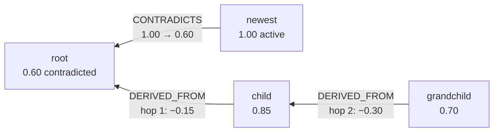
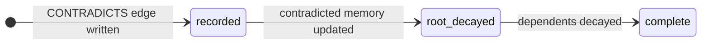

# Trust model

Every memory carries a `trust_score` between `0.05` and `1.0`. Trust drops when a
newer memory contradicts a claim, and that loss spreads to memories derived from it.
Every change is recorded as graph data, so `explain_trust` can say exactly why a
score moved.

All numbers on this page come from the live tests in `tests/test_tools.py` and
`tests/test_hardening.py`, and the values the demo in `examples/demo.py` produces.

## Rules

| Event | Effect on trust | Effect on status |
|---|---|---|
| `remember` or `revise` writes a memory | Starts at `1.0` | `active` |
| A newer memory contradicts an `active` memory | Contradicted memory loses `0.40` | `contradicted` |
| A contradicted memory has dependents (`DERIVED_FROM`) | Hop 1 loses `0.15`, hop 2 loses `0.30` | unchanged |
| `revise` replaces a fact | Old fact keeps its score; the new fact starts at `1.0` | old fact becomes `superseded` |
| `forget` | unchanged | `forgotten` |

Decay is subtractive, and no score falls below the floor of `0.05`:

```text
new_trust = max(0.05, old_trust - amount)
```

Propagation stops after two hops. If a memory is reachable at both hop 1 and hop 2,
it is decayed once, as hop 1. Forgotten memories are skipped.

## How contradictions are detected

Before a write, `check_conflict` looks at `active` memories in the same scope that
share at least one entity with the new memory. A small lexical classifier in
[`src/hydramind/conflict.py`](../src/hydramind/conflict.py) flags opposing polarity,
such as `always`/`never`, `must`/`must not`, `enabled`/`disabled`, or `allow`/`deny`,
when the rest of the claim overlaps.

The classifier is deliberately simple and replaceable. Paraphrased contradictions
are not caught yet; see
[#9](https://github.com/himanshu748/hydramind/issues/9) for the pluggable classifier.

## Worked example: a two-hop cascade

```text
remember("The deployment policy must always use direct routing.", scope, ["policy"])      -> root
remember("The release checklist derives from deployment policy.", scope, ["checklist"],
         derived_from=[root])                                                              -> child
remember("The runbook derives from the release checklist.", scope, ["runbook"],
         derived_from=[child])                                                             -> grandchild

remember("The deployment policy must not use direct routing.", scope, ["policy"])         -> newest
```

The last write shares the `policy` entity with `root`, and `must`/`must not` gives
it opposite polarity. HydraMind then:

1. Writes `newest` at trust `1.0`.
2. Writes `(newest)-[:CONTRADICTS]->(root)` with the reason, time, and trust change.
3. Lowers `root` from `1.0` to `0.6` and marks it `contradicted`.
4. Lowers `child` (hop 1) from `1.0` to `0.85` and writes a `TRUST_DECAY` event.
5. Lowers `grandchild` (hop 2) from `1.0` to `0.7` and writes a `TRUST_DECAY` event.



`recall("How should production route?", scope, ["policy"])` now ranks `newest`
(trust `1.0`) above `root` (trust `0.6`), and both remain auditable.

## Repeated contradictions accumulate

Each contradiction that reaches a dependent adds a new, immutable `TRUST_DECAY`
event. In `test_repeated_two_hop_decays_keep_every_trust_event`, a child sits two
hops below two independent roots, and both roots are contradicted:

| Event | Child trust |
|---|---|
| Start | `1.00` |
| Root A contradicted (hop 2) | `1.00 → 0.70` |
| Root B contradicted (hop 2) | `0.70 → 0.40` |

`explain_trust` on the child reports both decays in order.

## Explaining trust

`explain_trust(memory_id, scope)` walks the memory's `CONTRADICTS`,
`SUPERSEDED_BY`, and `TRUST_DECAY` edges and returns a dated, ordered narrative,
for example:

- the contradiction that lowered it, with the reason and trust before and after
- each derived decay, with the hop count and the root memory that caused it
- the revision that superseded it, if any

The dashboard's **Explain trust** button calls the same method.

## Crash safety and retries

HydraDB's Bolt runtime commits each statement on its own, so one contradiction takes
several writes. HydraMind records progress on the edges themselves:



Each `TRUST_DECAY` event uses the same `recorded` → `complete` pattern. Retrying a
keyed `remember` (same `idempotency_key`, same payload) resumes from the recorded
phase and never applies the same decay twice. Writes without a key, and revisions,
do not have this repair guarantee.

## Limits

- Detection is lexical, not semantic.
- Propagation is fixed at two hops and the decay amounts are constants. Making them
  configurable is tracked in [#7](https://github.com/himanshu748/hydramind/issues/7)
  and [#8](https://github.com/himanshu748/hydramind/issues/8).
- Trust never rises automatically. A corrected fact is a new memory (via `remember`
  or `revise`) that starts at `1.0`.
